<p align="center">
  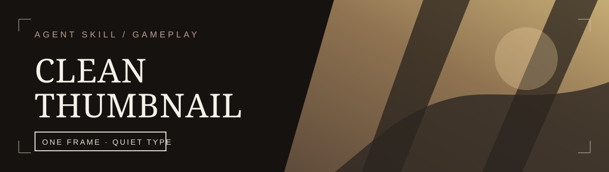
</p>

<h1 align="center">Clean Thumbnail</h1>

<p align="center">
  <strong>Real images. Quiet type. A thumbnail that reads in the feed.</strong><br/>
  An Agent Skill and local renderer for restrained YouTube thumbnails, for any kind of video,<br/>
  with Facebook feed and Reels/Shorts versions, plus standalone posts that keep the whole message.
</p>

<p align="center">
  <a href="LICENSE"></a>
  
  
  
  
  <a href="https://github.com/RZ-Logic/clean-thumbnail-skill/actions/workflows/tests.yml"></a>
</p>

<p align="center">
  <a href="#why-this-exists">Why</a> ·
  <a href="#the-principle">Principle</a> ·
  <a href="#examples">Examples</a> ·
  <a href="#creator-photo">Creator Photo</a> ·
  <a href="#example">Two Variants</a> ·
  <a href="#dawnwalker">Official Logo</a> ·
  <a href="#subject-demo">Subject Layer</a> ·
  <a href="#post">Feed Posts</a> ·
  <a href="#image-roles">Image Roles</a> ·
  <a href="#formats">Formats</a> ·
  <a href="#title-look">Title Look</a> ·
  <a href="#what-ships">What Ships</a> ·
  <a href="#quickstart">Quickstart</a> ·
  <a href="#quality-gates">Quality Gates</a> ·
  <a href="#tradeoffs">Tradeoffs</a> ·
  <a href="#installation">Installation</a> ·
  <a href="#verification">Verification</a>
</p>

---

<a id="why-this-exists"></a>
## 🧭 Why this exists

Many thumbnails, in gaming, tech, sports and self-help alike, use the same recipe: a cut-out with a glowing edge, a synthetic explosion, oversized distressed lettering, arrows, and one color pushed across the entire frame. Grain on top does not make that scene less manufactured. The lettering and the effects are the problem before any finishing pass begins.

Clean Thumbnail starts from real images: a game capture, a photo, official art, a cut-out of the creator. It gives them space to carry the mood, then typesets the few words a viewer can actually read in a feed. The renderer is deterministic: it does not generate a new world behind anyone or ask an image model to draw letters.

It suits gameplay, trailers, walkthroughs, hardware and settings comparisons, sports, education and vlogs, whenever you have images that represent the video. It cannot make a weak image compelling by itself.

<a id="the-principle"></a>
## 🧱 The principle

> **Real images carry the mood; the type stays quiet.**

The skill decides *what to say* from the video title: the big type is whatever makes this video different from every other video about the same thing. The Python script decides *where and how to render it*. Keeping text out of image generation makes spelling, spacing, and revisions controllable.

```text
Video title ─► what makes it different + context ─────────────┐
                                                               ├─► A/B pair: master (up to 4K)
Images ─► roles: background, panels, subject, inset ─► type ───┘    + 2 MB phone copy + previews
```

<a id="examples"></a>
## 🖼️ Worked examples

Each example renders an A/B pair from the same images and text: one variant with the subject big, the other with the hook big. The pair is meant for YouTube's Test & Compare on 16:9 long-form videos; see [Build decisions and limits](#tradeoffs) for what that test does and does not tell you.

<a id="creator-photo"></a>
### With a creator photo

For a fictional vlog titled *One take, no script: just press record*, the thumbnail copy is **ONE TAKE / NO SCRIPT**. A leads with the recording constraint; B leads with the unscripted approach. A stock model stands in for the creator in this example.

<p align="center">
  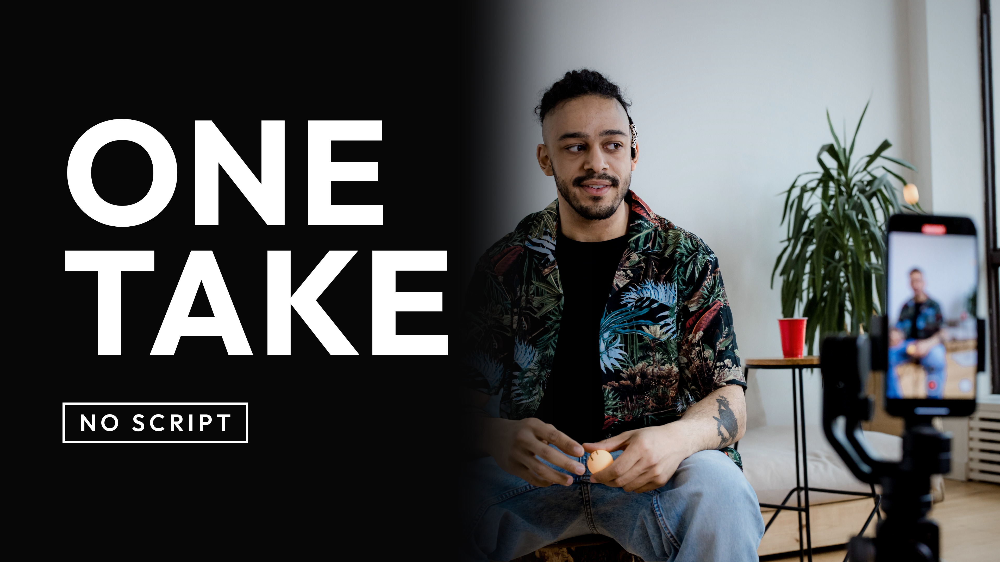
  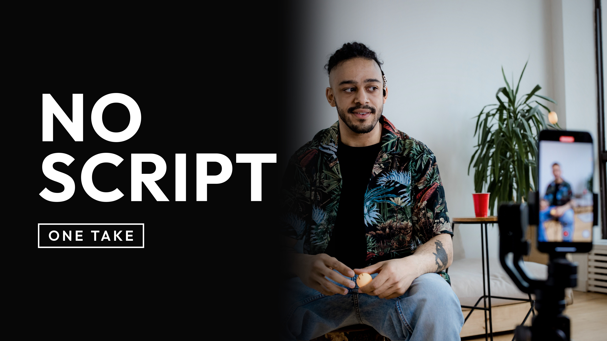
</p>

The [source photo](demo/creator-photo.jpg) is by [Ron Lach on Pexels](https://www.pexels.com/photo/a-man-creating-video-content-8360444/), used under the [Pexels License](https://www.pexels.com/license/). The creator sits in the middle with the camera phone on the right, so `--crop 0.2,0,0.85,1` keeps the part from the creator to the phone, the art moves right, and the type takes the dark left side. Both the creator and the phone screen showing him recording stay visible, which is what says "creator video". The shade is automatic: with a short title on a bright photo it darkens only the left, to 0.35, and the type still reads at 15.9:1. `--feather 0.2` shortens the fade so it doesn't reach his face. With no brand logo to match, both slots use the bundled Outfit family: Bold for the headline and SemiBold for the box, where Outfit stands in for a channel font.

```bash
python skill/clean-thumbnail/scripts/thumb.py demo/creator-photo.jpg --title "ONE TAKE" --label "NO SCRIPT" --style sans --title-font outfit@Bold --label-font outfit@SemiBold --text-side left --crop 0.2,0,0.85,1 --feather 0.2 --aspect 16:9 -o out/creator
```

Without the hand-picked crop, marking his face with `--subject-box 0.31,0.23,0.42,0.39` lets the script decide: the 16:9 type moves to the right, clear of his face, and the 4:5 and 9:16 crops center on him, with no warnings in any format. The crop above is still the better picture here, because it also keeps the phone in view, which the box doesn't know about.

The included source is resized to 3840×2560; the crop keeps 2496×2560 of it, and both masters render at 3840×2160 without upscaling. The [A preview](demo/creator_A_preview.png) and [B preview](demo/creator_B_preview.png) show the headlines at 168 px and in the squint test. The 1280×720 phone copies for [A](demo/creator_A_phone.jpg) and [B](demo/creator_B_phone.jpg) are under 2 MB. Source and derivative credits are recorded in [the photo license note](demo/creator-photo-LICENSE.md); the fictional copy does not describe the model's own video or imply an endorsement.

<a id="example"></a>
### One title, two variants

For a video titled *Clair Obscur Expedition 33 GOTY - Simon Fight (No hit - Only Parry) | Expert*, the subject is **SIMON** and the hook is **NO HIT · PARRY ONLY**. Which one should be big depends on the audience, so the renderer makes both: A with the subject big, B with the hook big. YouTube's [Test & Compare](https://support.google.com/youtube/answer/13861714) takes up to three thumbnails per video and picks the winner on watch time share, not click-through rate. It does not run on Shorts, Premieres, scheduled lives, made-for-kids or private videos, and tests of clearly different thumbnails finish faster, so make the two differ.

<p align="center">
  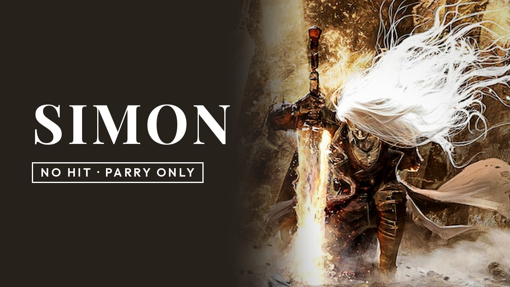
  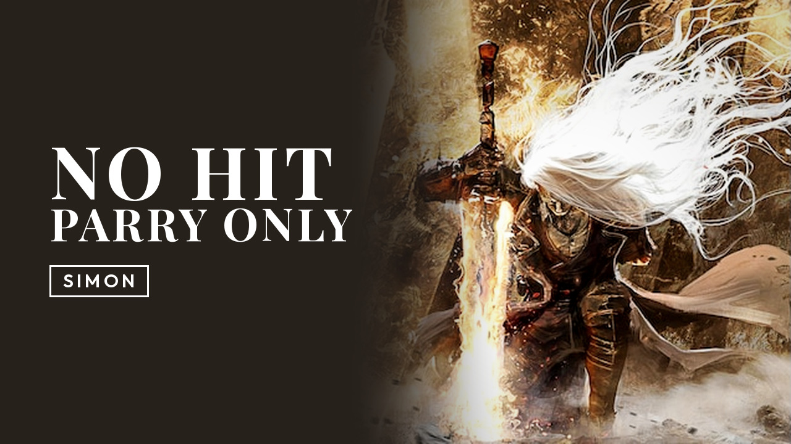
</p>

The [source capture](demo/simon-capture.jpg) and the preview sheets for [A](demo/simon_A_preview.png) and [B](demo/simon_B_preview.png) are included. Each preview shows the thumbnail at 480, 320, 168, and 120 px in dark and light feed settings with a duration badge, at the 88 px notification size, and as a squint test (grayscale plus blur) that shows what survives a fast scroll. The tool does not predict which variant will perform better.

<a id="dawnwalker"></a>
### With the official logo

For a *The Blood of Dawnwalker* video with the hook **OP SKILLS**, the game's official logo replaces the title text. A puts the logo first; B sets the hook big with the logo small above it. The key art has the character in the middle of the frame, so `--crop` keeps 78% of its width around him. Narrower than 16:9, the art moves to the right and fades into the dark side, which leaves the left for the type.

<p align="center">
  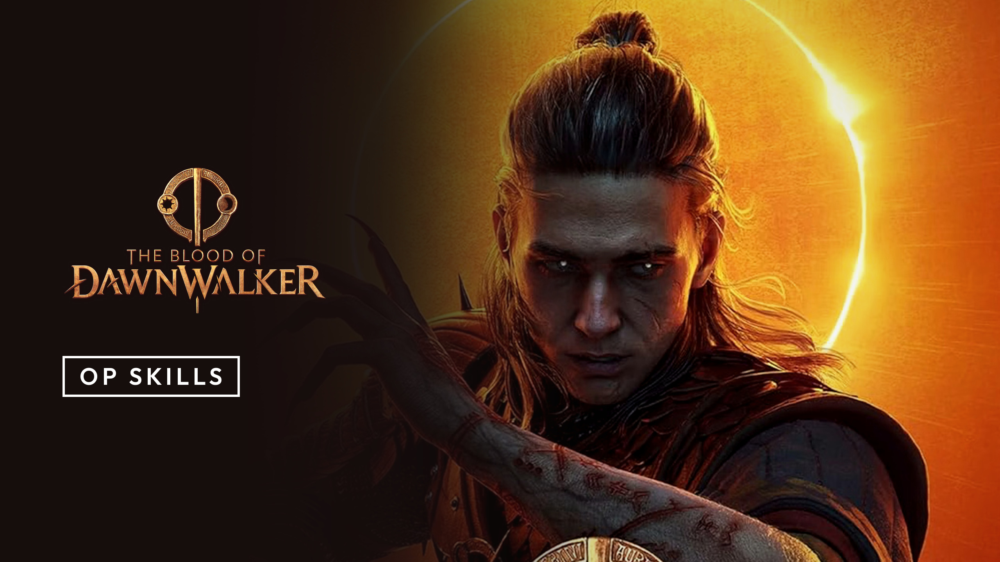
  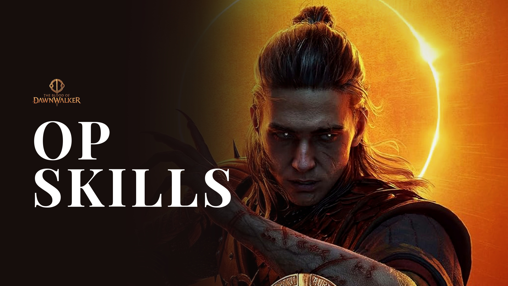
</p>

```bash
python skill/clean-thumbnail/scripts/thumb.py demo/dawnwalker-art.jpg --crop 0.117,0,0.898,1 --text-side left --logo demo/dawnwalker-logo.png --label "OP Skills" -o out/dawnwalker
```

The [key art](demo/dawnwalker-art.jpg) is 2560×1440, so both masters render at 2560×1440 without upscaling. The previews show the trade the pair is for: in [A](demo/dawnwalker_A_preview.png) the logo's thin gold lettering fades at 168 px and in the squint test, while the hook in [B](demo/dawnwalker_B_preview.png) holds. The logo reaches only 6.8:1 even at the full 0.88 shade, so A keeps that shade; B lightens to 0.35. The logo is the more recognizable mark; the hook is the more legible one.


<a id="subject-demo"></a>
### A cut-out over a separate background

For a fictional *A home studio in a small room* video, the copy is **HOME STUDIO / SMALL ROOM**. This example uses two photographs: a [transparent person](demo/subject-person.png) cut out from the Ron Lach creator photo, placed over a separate [room photo](demo/subject-room.jpg) by [Curtis Adams](https://www.pexels.com/photo/indoor-view-of-office-room-with-desk-and-laptop-at-home-11125425/). The stock model stands in for a creator; the room is an example setting.

<p align="center">
  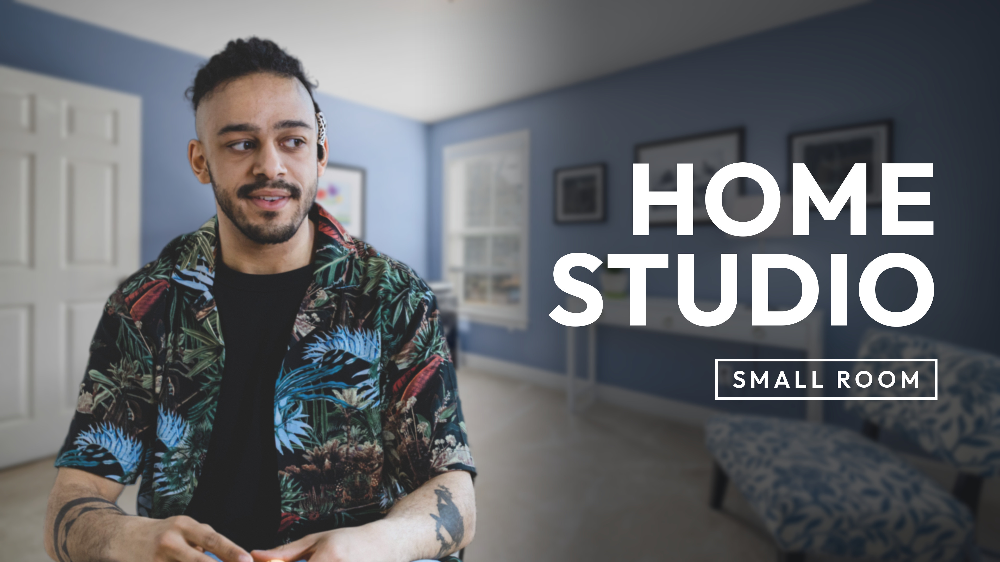
  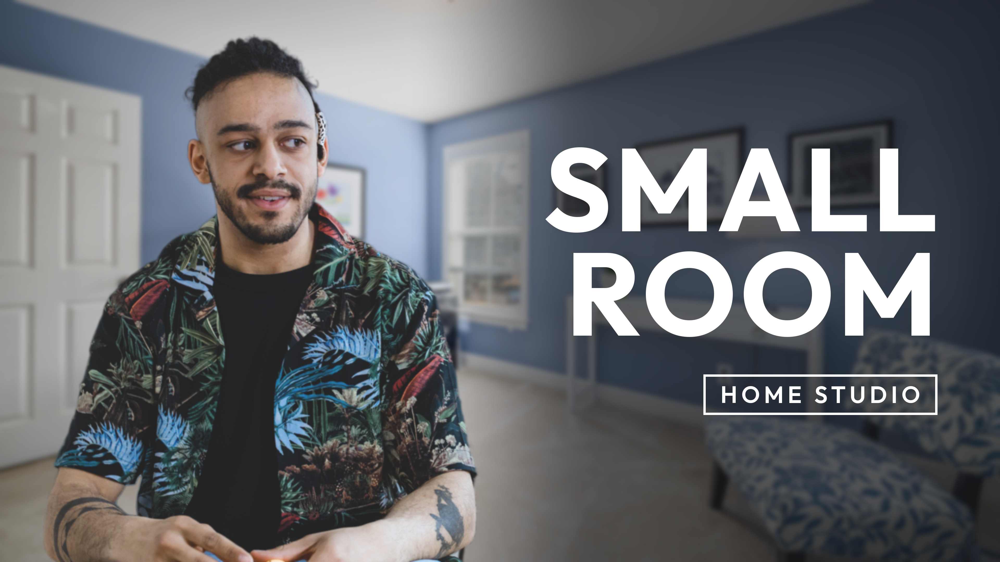
</p>

```bash
python skill/clean-thumbnail/scripts/thumb.py demo/subject-room.jpg --subject demo/subject-person.png --title "HOME STUDIO" --label "SMALL ROOM" --style sans --title-font outfit@Bold --label-font outfit@SemiBold --text-side right --push 0.35 --aspect 16:9 -o out/subject
```

`--subject` places the person on the left, away from the type, and `--push 0.35` softens the room behind him. The renderer matches the cut-out's color cast, black and white points, sharpness and grain to the background. Both slots use bundled Outfit in white, standing in for a channel font. The transparent PNG is included, so this command needs only NumPy and Pillow; background removal was a one-time preparation step.

The 4000×2250 room crop is scaled 0.96× and the 1924×2328 cut-out about 0.87×, so neither is upscaled for the 3840×2160 masters. The [A preview](demo/subject_A_preview.png) and [B preview](demo/subject_B_preview.png) show the headline and person at feed sizes; the [A phone copy](demo/subject_A_phone.jpg) and [B phone copy](demo/subject_B_phone.jpg) are 1280×720 and under 2 MB. The run reports 7.1:1 and 7.0:1 text contrast with no warnings: the automatic shade (0.65 here) darkens the room only as far as the type needs. Both source photos and the derivatives use the Pexels License; [the source and preparation note](demo/subject-LICENSE.md) records the credits.

<a id="post"></a>
### Standalone feed posts that keep the message

A thumbnail gets a few words because the video title carries the rest. A standalone post has no title, so its image text is the message. `--mode post` keeps the user's words: the headline as `--title`, the message as `--body` (wrapped, in the label font), and when and where as `--details`. Nothing is cut, reordered or moved into the caption. The script checks the body and details at the width of a phone feed (360 px; 300 px for a 9:16 post) and warns when they would be too small. A post renders one 4:5 image by default.

<p align="center">
  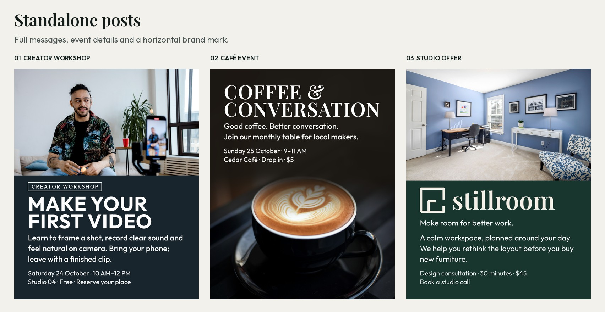
</p>

These are **fictional demonstrations**, including the businesses, events and offers. Each keeps its complete body and details on the image. The photographs are real, licensed sources; [the credits note](demo/post-LICENSE.md) identifies them. Every post below is rendered by the supplied `--mode post` implementation.

#### Creator workshop: headline, full message and booking details

A real creator photo with the person and recording phone kept together. The complete workshop description, date, time, venue and call to action sit on a solid panel below the clean photograph (`--backdrop solid`), rendered straight from the original photo. The face stays fully visible. The title uses bundled Outfit Bold; the body and details use Outfit Medium, in white.

```bash
python skill/clean-thumbnail/scripts/thumb.py demo/creator-photo.jpg --mode post --title 'MAKE YOUR FIRST VIDEO' --body 'Learn to frame a shot, record clear sound and feel natural on camera. Bring your phone; leave with a finished clip.' --details 'Saturday 24 October · 10 AM–12 PM\nStudio 04 · Free · Reserve your place' --label 'CREATOR WORKSHOP' --style sans --title-font outfit@Bold --label-font outfit@Medium --subject-box 0.31,0.23,0.42,0.39 --backdrop solid --bg '#18252D' -o out/post-creator
```

[Master](demo/post-creator_4x5.jpg) · [1080 copy](demo/post-creator_4x5_1080.jpg) · [Feed preview](demo/post-creator_4x5_preview.png) · [Photo](demo/creator-photo.jpg)

#### Café event: atmosphere, date, venue and price

A close-up coffee photograph carries the mood, with the type in the calm area above it. The serif headline uses bundled Playfair Display SemiBold; body and details use Outfit Medium. The whole invitation, date, opening hours, venue, drop-in instruction and $5 price remain on the image.

```bash
python skill/clean-thumbnail/scripts/thumb.py demo/post-coffee.jpg --mode post --title 'COFFEE & CONVERSATION' --body 'Good coffee. Better conversation.\nJoin our monthly table for local makers.' --details 'Sunday 25 October · 9–11 AM\nCedar Café · Drop in · $5' --title-font playfair@SemiBold --title-tracking 0.02 --label-font outfit@Medium --crop 0,0,1,0.9 --band top --bg '#1B1712' --shade 0.96 -o out/post-coffee
```

[Master](demo/post-coffee_4x5.jpg) · [1080 copy](demo/post-coffee_4x5_1080.jpg) · [Feed preview](demo/post-coffee_4x5_preview.png) · [Photo](demo/post-coffee.jpg)

#### Studio offer: a horizontal brand mark and a complete offer

**Stillroom** is a fictional studio created for this demo. Its supplied transparent logo keeps the room-plan mark **to the left of the name**. `--logo` occupies the title slot (a `--title` would not be drawn), so the complete offer, including the opening sentence, stays in `--body`. Paragraph spacing separates the promise from the explanation; `--details` retains the consultation length, price and call to action. The wordmark is part of the logo PNG (drawn in Playfair Display SemiBold), and the body uses Outfit Regular.

```bash
python skill/clean-thumbnail/scripts/thumb.py demo/subject-room.jpg --mode post --body 'Make room for better work.\n\nA calm workspace, planned around your day. We help you rethink the layout before you buy new furniture.' --details 'Design consultation · 30 minutes · $45\nBook a studio call' --logo demo/post-stillroom-logo.png --label-font outfit@Regular --backdrop solid --bg '#18352E' -o out/post-studio
```

[Master](demo/post-studio_4x5.jpg) · [1080 copy](demo/post-studio_4x5_1080.jpg) · [Feed preview](demo/post-studio_4x5_preview.png) · [Photo](demo/subject-room.jpg) · [Logo](demo/post-stillroom-logo.png)

The workshop and studio posts are rendered straight from the original wide photographs with `--backdrop solid`: the renderer keeps the photograph clean in its own rectangle and puts the type on an opaque panel of the `--bg` color, with a hard edge between them. The café uses a portrait photograph with the default fade. The sources are recorded in [post-LICENSE.md](demo/post-LICENSE.md); all final lettering is rendered locally, with no generated scene or replacement face.

| Post | Master | Body cap at 360 px | Details cap at 360 px | Minimum element contrast |
|---|---|---|---|---|
| Creator workshop | 1440×1800 | 10.7 px | 9.0 px | 12.4:1 |
| Café event | 2160×2700 | 10.5 px | 9.1 px | 13.4:1 |
| Studio offer | 1440×1800 | 10.5 px | 9.0 px | 10.6:1 |

All three commands finish without warnings. Every body and details word is preserved in order, the creator's face is 100% in frame and in the clean photograph, with no type over it, and the 1080×1350 copies are under 2 MB. [The measured report](demo/post-demo-report.json) records the exact text, wrapped lines, sizes and checks. The 360 px previews were also visually reviewed; these checks assess readability and layout, not engagement.

<a id="image-roles"></a>
## 🧩 Image roles

Every thumbnail is a small stack of real images in fixed roles, plus the type. New topics need no new layouts.

| Role | Flag | Use it for |
|---|---|---|
| Background | the capture | One frame, photo, or key art. The type goes on its calmer side over an adaptive shade in its own shadow color. Mark a face or product with `--subject-box` and the type, its shade and the vertical crops keep clear of it; when the subject sits in the middle, `--crop` narrows the art so it moves to the far side. |
| Panels | `--panel A --panel B` | Comparisons: versions, settings, before and after. A thin divider, a label per panel, the type in a band at the bottom. |
| Subject | `--subject cutout.png` | A person, character, or product in front of the background, on the side away from the type. |
| Inset | `--inset img --inset-box x0,y0,x1,y1` | An image inside the background, like a game frame on a monitor. |

Subjects and insets are matched to the photo behind them in color cast, black and white points, sharpness, and grain, so the stack reads as one photograph, with no white keylines, glows, or halos. Subjects need a transparent background; with [rembg](https://github.com/danielgatis/rembg) installed, the script removes it for you. The shade behind the type is automatic: the lightest that keeps every element at 7:1 contrast, so a short title darkens little of the picture. Flat dark fills are lifted to charcoal (`#222222` for a neutral) so the edge stays visible on YouTube's dark page; `--shade N` and `--bg` fix either.

<a id="formats"></a>
## 📐 Formats

The same images and text render for YouTube and for Facebook, Instagram, Reels, Shorts, and Stories.

| Format | Flag | Master | Copy | Where the type goes |
|---|---|---|---|---|
| YouTube 16:9 | default | up to 3840×2160 | 1280×720, under 2 MB | Beside the image, clear of the duration badge from the 168 px up-next size up |
| Feed 4:5 | `--aspect 4:5` | up to 2160×2700 | 1080×1350 | Below the image; above it when there is a subject |
| Reels and Shorts 9:16 | `--aspect 9:16` | up to 2160×3840 | 1080×1920 | Inside a conservative safe zone: clear of the top 14%, bottom 35%, and right 15% |

Vertical formats crop to the busiest part of the image, which is usually the subject, unless you set `--focus`; when that crop cuts a face the script finds, it warns and names the `--subject-box` to pass. Comparisons stack, with the type on the seam so both panels stay visible. `--aspect all` renders every format. Each gets its own preview: a Facebook-style feed card, or a Reels-style overlay with the profile-grid crop. The safe zone is a conservative preset: Meta's Reels ad guide suggests about 14% at the top, 35% at the bottom and 6% on each side, the right 15% covers the icon rail, and neither platform publishes a spec for organic covers.

Through the skill, you choose formats once. The first time, it asks which platforms you post to and saves the answer as `"aspect"` in `clean-thumbnail.json`; after that it renders those formats without asking. Naming a platform in a request ("make a Reels one too") replaces the saved formats for that run, so the skill lists every format it wants, or only the new one when the others already exist. Run directly without a saved setting, the script renders 16:9 and prints a note saying so.

<p align="center">
  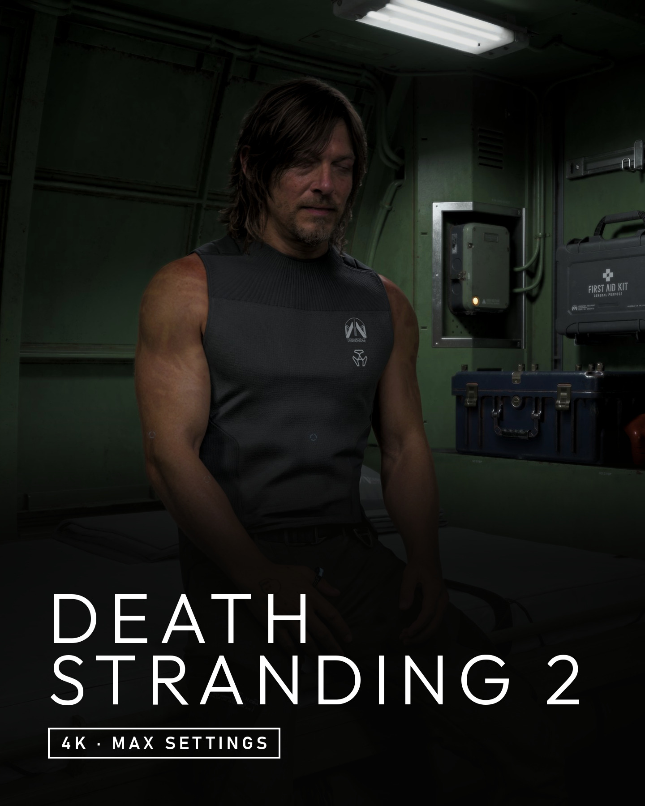
  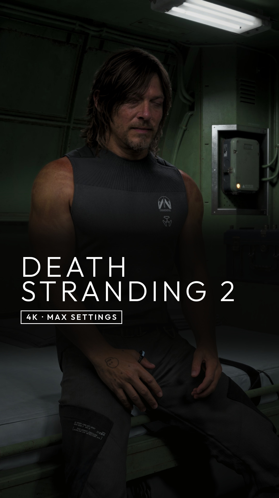
</p>

These come from the author's own 4K capture of *Death Stranding 2* (the [source](demo/ds2-capture.jpg)), with the title in the bundled `outfit` font at Light weight and wide spacing, like the game's thin, spaced-out logo:

```bash
python skill/clean-thumbnail/scripts/thumb.py demo/ds2-capture.jpg --title "DEATH STRANDING 2" --label "4K · Max settings" --title-font outfit@Light --title-tracking 0.12 --focus 0.46 --lead title --aspect 4:5,9:16 -o out/ds2
```

The [4:5 preview](demo/ds2_4x5_preview.png) shows it in a Facebook feed card and the [9:16 preview](demo/ds2_9x16_preview.png) under a Reels overlay with the profile-grid crop. The safe zone holds 9:16 type in the middle of the frame, so a face belongs in the top third, as Sam's does here. With a centered face, `--subject-box` moves the type band to the top when that clears it; without a box the band stays at the bottom and shades the face (the script warns when it finds the face there), and `--crop` can't move the type on this format. `--focus 0.46` centers Sam: on its own the crop follows the busiest part of the frame, which in this cabin is the equipment on the wall.

<a id="title-look"></a>
## 🔤 Title look and color

The big type should look like the thing in the video, not like every other thumbnail. The skill picks the look in this order:

1. **The official logo** (`--logo`), from the press kit or the official site, as in the [Dawnwalker example](#dawnwalker). The most authentic option, and what publisher thumbnails use.
2. **The closest bundled font** (`--title-font cinzel`): 16 open-licensed display faces, from Roman capitals and blackletter to stencil and pixel, matched to the logo with a [decision table](skill/clean-thumbnail/references/fonts.md), in weight and letter spacing as well as shape (`outfit@Light --title-tracking 0.12` for Death Stranding's thin, spaced-out logo). Close in spirit, not the real lettering.
3. **The channel's own font**, when nothing bundled fits. A wrong match looks worse than a neutral one. Without a channel font, the defaults are bundled Playfair Display Bold (serif) or Outfit Bold (sans), with Outfit SemiBold in the label box, so the type is the same on every machine.

The label box always keeps the channel font, so every thumbnail looks like its game and the channel still looks like one channel.

Color follows the same restraint: **white by default, one color at most.** `--title-color auto` takes the color the image is known for (an eclipse, a sunset, neon, a team kit) and lightens it only as much as it needs to pass 4.5:1 on the dark side. Gray scenes and skin tones don't count, so those stay white. A brand hex code works too. Color the big type or the label box, not both.

<p align="center">
  
  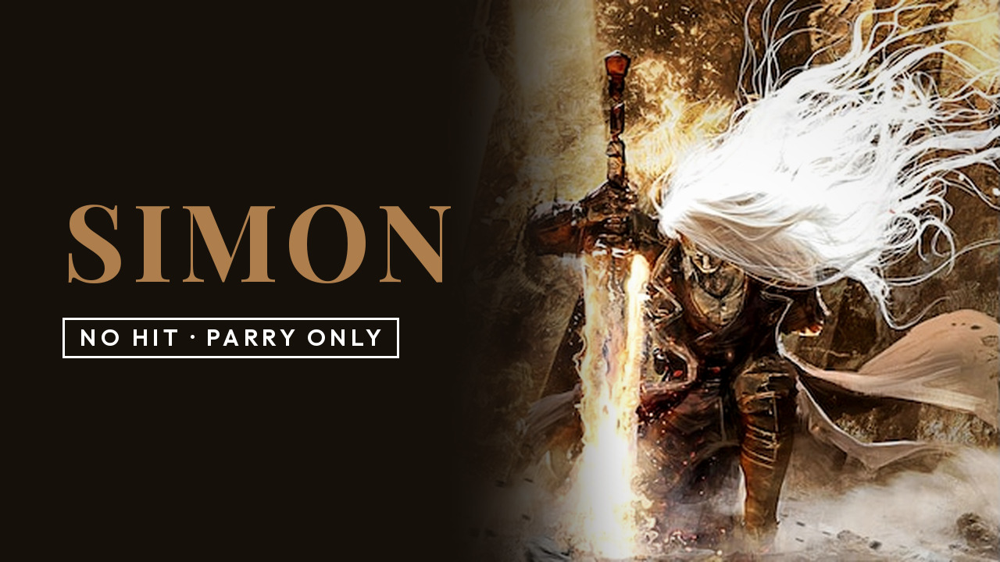
</p>

White (left) and `--title-color auto` (right): the art's gold `#a7753d` is lightened to `#b68d5f` so it reads at 5.3:1 (the lighter shade lets it lighten more than before). Every variant prints the look and colors it used.

<a id="what-ships"></a>
## 📦 What ships

| Part | Role |
|---|---|
| [Skill instructions](skill/clean-thumbnail/SKILL.md) | Assigns image roles, writes short thumbnail text or preserves a standalone post message, renders, and reviews the result. |
| [Type rules](skill/clean-thumbnail/references/type-rules.md) | Turns a video title into a subject and hook, or keeps a post message as headline, body and details. |
| [Channel settings example](skill/clean-thumbnail/references/channel.example.json) | Starting point for the saved formats; [the flag reference](skill/clean-thumbnail/references/flags.md) lists every channel key, flag, note and warning. |
| [Bundled fonts](skill/clean-thumbnail/fonts/) and [matching guide](skill/clean-thumbnail/references/fonts.md) | 16 open-licensed display fonts (Roman capitals to pixel) so the big type can look like the game, film, or brand, each with its `OFL.txt`; [`catalog.json`](skill/clean-thumbnail/fonts/catalog.json) lists their real family names, weights, spacing and the looks they fit. |
| [`agents/openai.yaml`](skill/clean-thumbnail/agents/openai.yaml) | Display name, short description and default prompt for Codex's skill list. |
| [`thumb.py`](skill/clean-thumbnail/scripts/thumb.py) | Composes, matches layers, typesets, checks, and exports. |
| [Demo](demo/) | Five thumbnail examples and three standalone posts: sources, logos, master and upload copies, reproduction commands, credits, and feed-size previews. |
| [Tests](tests/) | Resolution, layout, lead, image roles, layer matching, contrast, formats, cropping, fonts, colors, channel settings, and the CLI. |

The renderer runs locally with NumPy and Pillow. No image-generation service is in the rendering path.

<a id="quickstart"></a>
## ⚡ Quickstart

Try the included demo from this repository:

```bash
python -m pip install numpy pillow
python skill/clean-thumbnail/scripts/thumb.py demo/simon-capture.jpg --title "SIMON" --label "No hit · Parry only" -o out/simon
```

This writes `simon_A.jpg` and `simon_B.jpg` (masters), `_phone.jpg` copies for phone upload, and a `_preview.png` for each. The bundled capture is 637×358 with pillarbox bars around 358×358 art, so after trimming the bars (`--no-trim` keeps them) the renderer correctly warns that it upscales about 2×; it demonstrates layout rather than production sharpness. The [Dawnwalker example](#dawnwalker) starts from a 2560×1440 source and renders without upscaling.

For your own video, use a clean, high-resolution image with room for type on one side. The master comes out at the largest standard size your images support without upscaling, up to 3840×2160. Official press-kit art can work; publish only images you have the right to use. NVIDIA and Xbox Game Bar HDR captures are JPEG XR files the script cannot read: capture with HDR off or export SDR PNG or JPEG. If the frame is crowded, choose another moment before tuning the layout.

```bash
# comparison
python skill/clean-thumbnail/scripts/thumb.py --panel 25h2.png --panel 26h2.png --panel-label 25H2 --panel-label 26H2 --title "GAMING" --label "Which is faster" --style sans
# creator in front of a background
python skill/clean-thumbnail/scripts/thumb.py demo/subject-room.jpg --subject demo/subject-person.png --title "HOME STUDIO" --label "SMALL ROOM" --style sans --title-font outfit@Bold --label-font outfit@SemiBold --text-side right --push 0.35 --aspect 16:9 -o out/subject
# game frame on a monitor
python skill/clean-thumbnail/scripts/thumb.py crt.jpg --inset frame.png --inset-box 0.18,0.14,0.62,0.70 --title "DLSS 5" --label "On a CRT" --style sans
```

| Option | When to use it |
|---|---|
| `--mode post` with `--body TEXT` and `--details TEXT` | A standalone post instead of a thumbnail: keeps the whole message (headline, wrapped body, when and where), checks it reads at the phone feed width (360 px; 300 px for 9:16), and renders one 4:5 image unless `--aspect` or `--lead` is given. |
| `-o PATH` | Output stem, `.jpg` name or folder (default `<capture>_thumb`). Variants and formats add `_A`, `_B`, `_4x5`, `_9x16`, so a second run with the same `-o` keeps the first run's files. |
| `--style serif\|sans` | The default title look when no logo or matched font is given: bundled Playfair Display Bold or Outfit Bold. |
| `--panel A --panel B --panel-label L` | Comparison panels (2 or 3) instead of a capture, each with its label, in the same order. |
| `--kicker TEXT` / `--subtitle TEXT` | A small line above or below the big type; off unless given (see the [type rules](skill/clean-thumbnail/references/type-rules.md)). |
| `--lead title\|label\|ab` | Which slot is big. `ab` (default) renders both. |
| `--text-side left\|right` / `--focus 0..1` | Override the calmer side (16:9); move the horizontal crop on a wide source. |
| `--crop x0,y0,x1,y1` | Keep part of the capture (fractions of it as given). Narrower than 16:9, the art moves to the far side, which makes room for the type. |
| `--subject-box x0,y0,x1,y1` | Mark the face (brows to chin) or a product's label. The type, the shade and the 4:5 and 9:16 crops keep clear of it, and a warning names a fix when they can't. The preview gets a last tile outlining the box (and `--inset-box`). |
| `--band auto\|top\|bottom` | Where the type band goes on 4:5 and 9:16; `auto` takes the top when that keeps a subject box or inset clearer. |
| `--backdrop fade\|solid` | `fade` (default): the photo darkens into the shade. `solid`: the photo stays clean and the type sits on an opaque `--bg` panel; `--shade` and `--feather` do nothing. |
| `--shade 0..1` / `--bg #hex` | Without `--shade` the shade is automatic: the lightest from 0.35 to 0.88 that keeps every element at 7:1 contrast. A number fixes it. `--bg` sets the color (default: the image's shadows, lifted to charcoal). |
| `--feather 0..1` / `--push 0..1` | Fade length of narrow or cropped art (default 0.36); softening of the background behind subjects (default 0.5). |
| `--logo logo.png` / `--logo-white` / `--no-logo-white` | Use a transparent logo in place of title text (a `--title` is not drawn); recolor it white; keep its colors over a saved `true`. |
| `--title-font NAME\|FILE` / `--label-font` / `--list-fonts` | A bundled font matched to the game's or brand's lettering (`cinzel`, `bebas`, `orbitron`...), or your own file; optional `@Weight`. |
| `--title-tracking 0..0.5` | Letter spacing of the big type in em. Wide (0.1 to 0.2) for a thin, spaced-out logo. |
| `--system-fonts` / `--no-system-fonts` | Installed faces (Bodoni MT, Bahnschrift, Didot) instead of the bundled Playfair Display and Outfit; the look then depends on the machine. The second flag overrides a saved `"system_fonts": true`. |
| `--title-color white\|auto\|#hex` / `--accent` | Big type color; label box color. `auto` takes the image's signature color and lightens it just enough to read. Color one, not both. |
| `--no-trim` | Keep the capture and panels whole instead of trimming black bars (a logo or product on black can pass for bars). |
| `--aspect 16:9,4:5,9:16` | Formats to render; `all` for every one. A value here replaces the saved formats for that run. |
| `--size 720p\|1080p\|1440p\|4k` | Force the 16:9 master size. |
| `--channel FILE` | Channel settings; only `./clean-thumbnail.json` in the working folder loads on its own. Flags win for that run. |
| `--feed DIR` | Place both variants in a grid with thumbnails from a local folder. |

Every flag, the notes and warnings you will see and what each one asks for are in [the flag reference](skill/clean-thumbnail/references/flags.md).

The [type rules](skill/clean-thumbnail/references/type-rules.md) keep **thumbnail** text at eight words or fewer. **Posts** keep the complete message and check its readability at phone feed size.

<a id="quality-gates"></a>
## 🔍 Quality gates

| Check | What the renderer does |
|---|---|
| Image preparation | Trims letterbox and pillarbox bars (a night sky or a logo on black is left alone; `--no-trim` keeps them), converts embedded ICC profiles to sRGB, reads 16-bit and transparent images, applies `--crop` in the coordinates of the image as given, picks the master size without upscaling, and warns when a small source, cut-out, inset or logo still needs it. HDR JPEG XR and HEIC files get a specific error. |
| Type placement | Picks the calmer side (or the side with room beside an inset or clear of `--subject-box`), shrinks the type to fit, keeps cut-outs and the duration badge clear, and warns when type overlaps a subject or inset or is wider than its column at the smallest size. Fixes it names are confirmed by re-rendering. |
| Post message | Keeps every body and details word in order; breaks a link wider than the column at its slashes; shrinks the headline before the body; warns below 8 px cap height at the phone feed width (360 px, 300 px for 9:16) and when a word or line cannot fit; prints the laid-out lines; exports one post by default. |
| Subject box | Measures where `--subject-box` landed in every format (in frame or in the Reels safe zone, visible, under heavy shade, under type), prints it, and warns with a re-run-confirmed fix when the face is shaded, covered or cut off. Without a box the side and the crops still follow edge activity, but the script looks for a face (OpenCV's frontal face cascade, run in NumPy) and warns, naming the `--subject-box` to pass, when the type, its shade or a crop covers or cuts one; the preview outlines it. It finds faces turned toward the camera, not backs of heads or profiles, and it moves nothing itself (`--no-face-check` skips it). |
| Layer matching | Matches each subject and inset to the photo behind it in color cast, tone, sharpness, and grain, and prints what it changed. |
| Contrast | Scores every element against WCAG 4.5:1 at its worst letter-sized slice (title lines, kicker, subtitle, label box, logo, panel labels). The automatic shade aims for 7:1; the script darkens the type area once when light type still fails, and names the element and the fix when it can't. |
| Type look | Uses the official logo, else the bundled font closest to the lettering, else the channel font; warns about missing characters (accents, other scripts, the middle dot), all-caps blackletter or script, unknown weights, and type that is small or too thin on the smallest tile. Numbers use lining figures where the font can (it warns where not), tracked type no longer collides at "fi" and "ff", and right-to-left and joining scripts are drawn shaped. `auto` colors are lightened until they pass; two different accent colors get a warning. |
| Safe zones | Keeps 16:9 type out of the duration-badge corner (sized to the 168 px up-next tile; it notes when the badge touches a label at 120 px) and 9:16 type and panel labels inside the conservative Reels/Shorts zone, and warns when it can't. |
| Inputs | Stops with a clear message on a missing file or font, an opaque logo, a fully transparent cut-out, conflicting roles, a `--crop` that leaves nothing, bad channel settings, an unwritable `-o`, or an `-o` that is an input file. Outputs are written atomically. |
| Export | Writes a master at the largest size the images support, a standard-size copy (1280×720 under 2 MB for YouTube, 1080 wide for vertical), and a preview sheet per variant and format, with a last tile that outlines `--subject-box` and `--inset-box`. |

These checks catch mechanical failures. They do **not** measure click-through rate, choose the best image, or guarantee that the subject is legible. Look at the previews and fix open warnings before publishing.

<a id="tradeoffs"></a>
## ⚖️ Build decisions and limits

- **Real images over generated backdrops:** the thumbnail shows what the viewer will actually see, but it depends on useful images. The script cannot invent a better camera angle.
- **Quiet compositing over the cut-out template:** subjects are matched to the photo instead of outlined and lit up. It reads as a photograph, at the cost of the instant pop the loud style buys.
- **Two variants over one guess:** whether the subject or the hook should be big depends on the audience, so the renderer makes both and leaves the choice to YouTube's Test & Compare (16:9 long-form only), which picks on watch time share rather than click-through rate. It is a pair, not a promise of a third variant.
- **Editable type over model-drawn text:** spelling and hierarchy remain controlled, but the result is intentionally quieter than a dramatic logo. Use `--logo` when the official mark carries recognition better.
- **One color over a palette:** white by default, and at most one color taken from the image or the brand. `auto` picks the image's most vivid color family, which is not always the one you would choose, and lightens deep colors toward pastel; pass a hex code when you know the color.
- **Feed-size review over full-size polish:** the 168 px and 120 px previews expose unreadable text early. Fine detail that only works at 4K is not a thumbnail advantage.

The tool composes, matches, and grades real images; it does not fabricate scenes, draw insets in perspective, or replace the need to test variants with viewers. Quiet thumbnails are a bigger bet in categories where loud is the norm; the feed grid and Test & Compare (which rewards watch time, not just clicks) will tell you per channel.

<a id="installation"></a>
## 🛠️ Installation

**Claude Code:** copy `skill/clean-thumbnail/` to `~/.claude/skills/clean-thumbnail/` (all your projects; `%USERPROFILE%\.claude\skills\clean-thumbnail\` on Windows) or to `.claude/skills/clean-thumbnail/` in a repository (that project only; commit it and your team gets it too), run `python -m pip install numpy pillow`, then ask for a thumbnail with a video title and your images, or type `/clean-thumbnail`.

**Codex:** copy `skill/clean-thumbnail/` to `~/.codex/skills/clean-thumbnail/`, install NumPy and Pillow, then invoke `$clean-thumbnail` with a video title and your images.

**Clients accepting Agent Skills ZIPs:** download `clean-thumbnail.zip` from the latest [GitHub Release](https://github.com/RZ-Logic/clean-thumbnail-skill/releases); it is attached to every release, so there is nothing to build. To build it yourself, run `python tools/build_zip.py` and upload `dist/clean-thumbnail.zip`.

**Direct Python:** run [`thumb.py`](skill/clean-thumbnail/scripts/thumb.py) as in Quickstart. It uses its bundled fonts by default, so the type is the same on every system; `--system-fonts` uses installed faces instead (Bodoni MT, Bahnschrift, Didot), and any font file can be passed in. For automatic background removal on subjects, also `python -m pip install rembg`.

<a id="verification"></a>
## 🧪 Verification

```bash
python -m unittest discover -s tests
```

The suite covers master sizing and layout for all three formats, the Reels safe zone, subject-following crops, panels, subjects, insets, layer matching, per-element contrast and the automatic shade, logos, bundled fonts and tracked and shaped text, title and label colors, cropping and bar trimming, the subject box and its suggested crops, post mode (wrapping, long links, every word kept), the demo commands, previews, channel settings, and the CLI, with regression tests for the defects those reviews found. `python tools/mutate.py` puts each fixed bug back into a copy of the renderer and confirms its test fails: all 341 tests pass and all 306 mutants are caught by a failing assertion (a few, where the old bug was itself an exception, by that exception; any other crash doesn't count). `CT_FAST=1` skips the 8 slowest tests for quick local runs, and `python tools/build_zip.py [out.zip]` builds the same ZIP, byte for byte, on any machine. GitHub Actions runs the suite on Windows, macOS and Linux, plus Python 3.8. The `demo/` folder is for visual inspection and is not in the Agent Skills ZIP.

For a short review path, read the [type rules](skill/clean-thumbnail/references/type-rules.md), compare the [capture](demo/simon-capture.jpg) with [variant A](demo/simon_A.jpg), [variant B](demo/simon_B.jpg) and a [preview](demo/simon_A_preview.png), then read [the renderer](skill/clean-thumbnail/scripts/thumb.py).

---

## 📜 License and author

MIT; see [LICENSE](LICENSE). Built by [Rizwan Ahmed](https://github.com/RZ-Logic).

The face model, [`haarcascade_frontalface_alt2.xml`](skill/clean-thumbnail/models/haarcascade_frontalface_alt2.xml) by Rainer Lienhart, comes from [OpenCV](https://github.com/opencv/opencv/tree/4.x/data/haarcascades) under the Intel open-source license in its header.

The bundled fonts are from [Google Fonts](https://github.com/google/fonts) under the SIL Open Font License; each family's license is next to it in `skill/clean-thumbnail/fonts/<name>/OFL.txt`: Cinzel, Playfair Display, MedievalSharp, Grenze Gotisch, Bebas Neue, Oswald, Teko, Rajdhani, Orbitron, Outfit, Nunito, Black Ops One, Press Start 2P, Kaushan Script, Zilla Slab, Courier Prime.

The game images in `demo/` and `tests/` are third-party game art, included only to show what the renderer does and to test it. They are not covered by the MIT license and belong to their owners; *The Blood of Dawnwalker* key art and logo are by Rebel Wolves, published by Bandai Namco Entertainment; the *Death Stranding 2: On the Beach* frame is the author's own capture of the game by Kojima Productions and Sony Interactive Entertainment; `tests/black_flag_edward.jpg` is a reduced copy of the author's own capture of *Assassin's Creed IV Black Flag Resynced* by Ubisoft, used by the face-check tests; the Simon painting is official splash art from *Clair Obscur: Expedition 33*, © 2025 Sandfall Interactive, published by Kepler Interactive (the official card credits art director Nicholas Maxson-Francombe), cropped from the copy on the [Hero Wiki](https://hero.fandom.com/wiki/Simon_(Clair_Obscur:_Expedition_33)). Rights holders can ask for any demo image to be removed by opening an issue.

The creator photo, the subject-layer room photo, the coffee photo and their rendered derivatives use the Pexels License, separately from the MIT code license. See [the creator photo credit](demo/creator-photo-LICENSE.md), [the subject-layer sources](demo/subject-LICENSE.md), and [the post-demo credits](demo/post-LICENSE.md).
